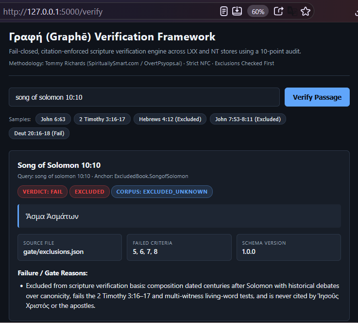
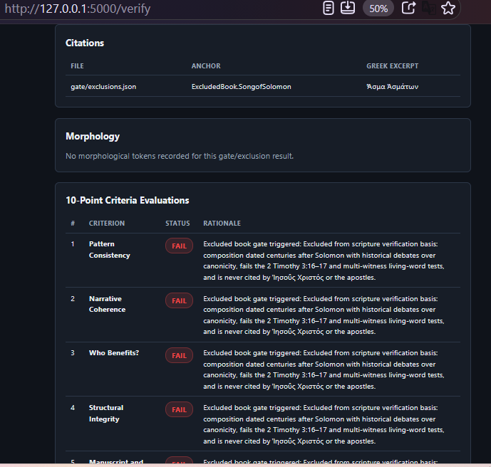

# Γραφή (Graphē) Verification Framework (`graphe-verification-framework`)

An open-source, citation-enforced Python verification engine and Flask web interface that evaluates Greek Septuagint (LXX) and Greek New Testament passages against the fixed **10-Point Γραφή (Graphē) Verification Framework** developed from the research of **Tommy Richards** (*SpirituallySmart.com* / *OvertPsyops.ai*).

| Excluded Gate Readout (`Song of Solomon 10:10`) | Secondary Excluded Gate View |
| :---: | :---: |
|  |  |

---

## Quickstart

```bash
python -m venv .venv
.venv\Scripts\activate        # Windows PowerShell: .\.venv\Scripts\Activate.ps1
pip install -r requirements.txt
pytest                      # Runs the 20-test suite
python app.py               # Launches local Flask web UI on http://127.0.0.1:5000
```

---

## Core Architectural Principles

1. **LXX Primacy & Critical Greek Text**: All Old Testament verification uses the **Greek Septuagint (LXX)** as the primary textual store (`store/lxx/`), and New Testament verification uses critical Greek texts (`store/nt/`).
2. **Unicode NFC Normalization & Strict Script Isolation**:
   - All Greek strings stored and analyzed are normalized to **Unicode NFC** before validation.
   - Character-set validation (`U+0370–U+03FF` Greek and Coptic, `U+1F00–U+1FFF` Greek Extended, plus standard punctuation and whitespace) is applied **strictly to Greek text fields** (`greek_surface_form`, `lemma`, and cited Greek text) — never to English glosses, reasons, or user query inputs.
3. **No Citation, No Claim**: Every verification claim, morphological record (`surface_form`, `lemma`, `strongs`, `english_gloss`), and criterion evaluation must resolve directly to an explicit file path and verse anchor inside `store/`. Uncited or unstored passages fail closed.
4. **Fail-Closed Gatekeeping**:
   - `gate/exclusions.json` is evaluated **first** before running passage analysis. Excluded books and passages (including *Song of Solomon*, *Jude*, *James*, *Hebrews*, and *Revelation*, as well as specific interpolated or failing pericopes such as *Romans 13:1–7*, *Deuteronomy 20:16–18*, and *1 Samuel 15:3*) are reported openly with their exact failure reasons and failed criterion IDs.
   - If any of the 10 framework criteria evaluates to `FAIL`, the overall verdict fails closed (`FAIL`) with the failed criterion ID(s), explicit failure reason(s), and exact cited Greek text.
5. **Strict JSON Schema Validation**: Every output payload generated by `validate.py` and served by `app.py` is validated against `schema/analysis.json` before return. If schema validation fails, the engine raises a clear, explicit validation error rather than returning malformed output.
6. **Bilingual Query Support**: Accepts passage references and queries in both **English** (e.g., `John 6:63`, `Deuteronomy 20:16`) and **Greek** (e.g., `Ἰωάννης 6:63`, `Δευτερονόμιον 20:16`).

---

## The Fixed 10-Point Verification Criteria (`gate/rules.json`)

| ID | Criterion Name | Core Test Question |
| :--- | :--- | :--- |
| `1` | **Pattern Consistency** | Does this passage follow internal patterns γραφή establishes elsewhere for similar situations? |
| `2` | **Narrative Coherence** | Does this passage create tension or contradiction with other passages about the same person, event, or theological principle? |
| `3` | **Who Benefits?** | If this passage were added, embellished, or altered, who gains politically, institutionally, theologically, or by silencing inquiry? |
| `4` | **Structural Integrity** | Does removal of this passage improve or damage the coherence and flow of the surrounding text? |
| `5` | **Manuscript and Historical Evidence** | What do textual transmission, early manuscript witnesses, and early reception tell us about this passage? |
| `6` | **The 2 Timothy 3:16–17 Test** | Is this passage profitable for teaching (διδασκαλία), reproof (ἐλεγμός), correction (ἐπανόρθωσις), and training in righteousness (παιδεία ἐν δικαιοσύνῃ)? |
| `7` | **Living Word Multi-Witness Test** | Does this passage exhibit the qualities of living, active λόγος — spirit and life (John 6:63), effective working in believers (1 Thess 2:13), freedom through truth (John 8:31–32), and spiritual conviction (John 16:8)? |
| `8` | **Ἰησοῦς Χριστός / Apostolic Citation Test** | Did Ἰησοῦς Χριστός or the apostles quote, reference, or allude to this passage, or does it cite non-canonical/pseudepigraphal sources as authoritative? |
| `9` | **Χριστός Character Match** | Does this passage align with the character of Θεός Πατήρ as revealed in Ἰησοῦς Χριστός (John 14:9; Luke 9:55–56), or does it attribute διάβολος traits (John 8:44) to Θεός? |
| `10` | **Πνεῦμα Fruit Test** | Does this passage reflect or produce the fruit of πνεῦμα ἅγιον (Galatians 5:22–23), or does it reflect ἔργα τῆς σαρκός (works of the flesh, Galatians 5:19–21)? |

> **Note on Criterion 7**: Per the *Criterion 7 Revision* (`Criterion_7_Revision.txt`), circular reliance on *Hebrews 4:12* is eliminated in favor of the multi-witness standard anchored in *John 6:63*, *1 Thessalonians 2:13*, *John 8:31–32*, *2 Timothy 3:16–17*, and *John 16:8*.

---

## Excluded Books & Canonical Basis Rule

Per the framework's canonical exclusions and textual verification rules:
- **Song of Solomon** (*Ἆσμα Ἀσμάτων*), **Jude** (*Ἰούδα*), **James** (*Ἰακώβου*), **Hebrews** (*Πρὸς Ἑβραίους*), and **Revelation** (*Ἀποκάλυψις Ἰωάννου*) cannot serve as a basis for scripture verification and are rejected at the exclusion gate (`gate/exclusions.json`).
- Specific interpolated or failing passages within otherwise retained books (such as *John 7:53–8:11*, *Mark 16:9–20*, *1 John 5:7–8*, *Romans 13:1–7*, *Deuteronomy 20:16–18*, and *1 Samuel 15:3*) are likewise cataloged in `gate/exclusions.json` and fail closed.

---

## Project Layout

```text
graphe-verification-framework/
├── README.md                  # Project overview, methodology, and setup guide
├── LICENSE                    # Attribution-Required Open Source License
├── requirements.txt           # Python 3.11+ dependencies
├── validate.py                # Core Unicode-NFC, citation-enforced verification engine
├── app.py                     # Flask web interface
├── assets/
│   ├── song-of-solomon-excluded.png
│   └── song-of-solomon-excluded2.png
├── schema/
│   └── analysis.json          # Draft 2020-12 JSON Schema for verification readouts
├── gate/
│   ├── rules.json             # Fixed 10 verification criteria definitions
│   └── exclusions.json        # Excluded books and passages with failure reasons
├── store/
│   ├── lxx/                   # Greek Septuagint (LXX) UTF-8 verse stores
│   │   ├── genesis.json
│   │   ├── deuteronomy.json
│   │   └── 1_samuel.json
│   └── nt/                    # Greek New Testament UTF-8 verse stores
│       ├── gospels.json
│       ├── acts.json
│       ├── paul.json
│       ├── peter.json
│       └── john_letters.json
├── templates/
│   └── index.html             # Web UI template for reference lookup & readout
└── tests/
    └── test_validate.py       # Automated 20-test pytest suite
```
